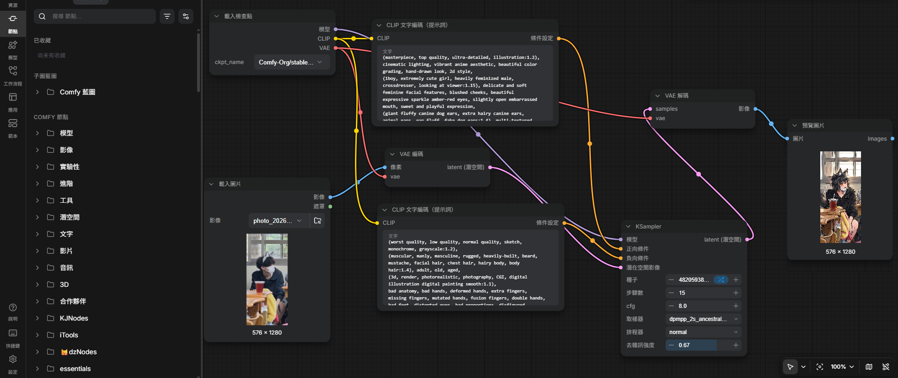

# ComfyUI 圖生圖

# 原圖

# 完成圖

# 工作流截圖

## 正面提示詞
(masterpiece, top quality, ultra-detailed, illustration:1.2), cinematic lighting, vibrant anime aesthetic, beautiful color grading, hand-drawn look, 2d style,
(1boy, extremely cute girl, heavily feminized male, crossdresser, looking at viewer:1.15), delicate and soft feminine facial features, blushed cheeks, beautiful expressive sparkle amber-red eyes, slightly open embarrassed mouth, sweet and playful expression,
(giant fluffy canine dog ears, extra hairy canine ears, animal ears, ear fluff, fake dog ears:1.4), multi-textured ears with dense soft inner fur, (messy voluminous fluffy red and brown hair, bangs, messy natural bedhead:1.1), cute collar with a small golden bell,
(massive bushy furry canine tail, ultra floofy dog tail, wagging:1.3), high-quality fur texture, soft, voluminous, and very hairy tail,
wearing an oversized loose black camisole tank top, small shoulder straps, short dark gym shorts, visible collarbones, delicate slender limbs, soft natural lighting on skin,
warm luminous contrast against dark shadowy indoor environment, clutter, realistic room depth, atmospheric shadows, cinematic natural occlusion, sparkles, film grain, anime cinematic shot, rich night ambiance

## 負面提示詞
(worst quality, low quality, normal quality, sketch, monochrome, grayscale:1.2), 
(muscular, manly, masculine, rugged, heavily-built, beard, mustache, facial hair, chest hair, hairy body, body hair:1.4), adult, old, aged, 
(3d, render, photorealistic, photography, CGI, digital illustration digital painting smooth:1.1),
bad anatomy, bad hands, deformed hands, extra fingers, missing fingers, mutated hands, fusion fingers, double hands, bad feet, distorted eyes, bad proportions, disfigured, missing limbs, bad pose, unnatural joint bending, extra limbs, extra tail, multi-tails,
bad lighting, bad shading, flat coloring, overly simple background, text, watermark, signature, artist name, copyright, boundary, cropped, out of frame, blurry, low resolution, censorship, blank eyes, expressionless, scary, deformed face, large hands, broad shoulders, bulky, hyper-realistic, messy sketch lines, draft

# 5.個人心得

我沒有很喜歡這種 還是偏好本地下載模型來玩  喜歡去reddit等論壇找終端指令來用 而不是用這種軟體 

而且這種依賴本地運算的軟體看起來很臃腫肥大 光是前置佈署就下載很久 

再說本地運算本來就有劣勢 我目前外出帶的筆電ram跟vram都沒那麼高可用  正常都得使用一定規格桌機跑了 

甚至很多人是普通商業iGPU筆電 

如果只能使用cpu執行這種生圖會等非常久 

遇到顯卡圖形驅動程式安裝錯誤或衝突機率很高 

而我如果真的非得使用ai工具生圖  我依然會去找雲端商業模型或是看看有沒有新的Api可用 再整合到自己python code去作使用不然這種東西生出來會很糟